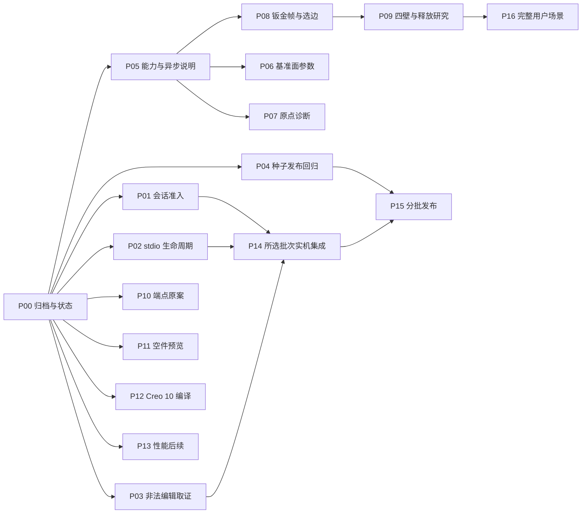

# 0.10.0 后续完善 Implementation Plan

> **For agentic workers:** REQUIRED SUB-SKILL: Use superpowers:subagent-driven-development（推荐）或 superpowers:executing-plans 逐任务实施；以下使用复选框跟踪。离线工作可委派，Creo 通道始终由一名编排人串行管理。

**Goal:** 将五份 0.9.0 反馈与 0.10.0 已交付事实逐项对账，分批消除剩余缺陷、参数使用障碍与发布复发风险，并建立钣金能力和用户场景的可验收推进路径。

**Architecture:** 保留 MCP→bridge→generic_bridge→原生 Toolkit 单通道架构。新业务逻辑放包内，工具说明/能力/共享 schema 同步；调查、修复、能力扩展、原案验收分别收口，每批可独立交付。

**Tech Stack:** Windows x64、PowerShell、Python 3.12+、unittest、Pydantic、stdio MCP、C++17、Creo 12.4.0.0/匹配 SDK/MSVC；Creo 10 编译由实际可用 SDK 的环境补证。

**Spec:** [0.10.0 后续完善范围与交付设计](../specs/2026-10-31-post0100-design.md)。日期：2026-10-31（Asia/Shanghai）；状态：计划待审阅，P00–P16 尚未实施。当前本地 HEAD `65c9159`，版本仍为 0.10.0。

## Global Constraints

- 以 N00–N13 全部交付、0.10.0 已正式发布为起点；标签交付提交 `17a36b9`，回填 `4364cea`/`65c9159` 单列。禁止覆盖已发布标签和同名附件。
- 本机联调仅 `MCP_CREO_MechDog_dev`，路径 `E:\Projects\MCP_CREO_MechDog`；按 BUG-001/BUG-091 条件核对后才能连接，不因计划形成而解除冻结。
- Toolkit 通道忙立即拒绝，`isError=true/status=busy` 并保留 blocking 信息；不排队、不自动重试，不假设 FIFO。已受理只轮询 `creo_get_job`。
- 不擅自结束/重启 Creo，不清 unknown 保护；异常后停止新提交并取证。历史受限重启授权不延伸到本轮。
- 业务逻辑新增到 `src/creo_mechdog/`，根兼容入口与包内类型同源，服务 stdout 只承载 MCP；不将 Python 计算当原生建模结果。
- 长度 mm、角度度；特征标签小写字母开头，仅小写/数字/下划线，最多 28 字符。
- 所有新增工作在实现前登记固定 ID、范围、环境和验收。建议 DEV-053/BUG-094/BUG-095 尚未登记，P00 检查冲突后再确定。
- 新增单元放 `tests/unit/`，使用 unittest；输入校验/保护变更必须补回归。原生变更须本次构建、实际几何/参数/保存重载与适用回滚证据。
- 不复用 1710/1710 冒充本次单元结果，不将 0.10.0 历史实机标成本次通过；记录提交、dirty、指纹、命令、环境和未测范围。
- Creo 9/10 未验事实保留；不新增 Creo 10 全项目复测、双版本、WorkBuddy 强制发布门槛。
- 保留现有 dirty 内容；历史 `docs/validation/` 原件逐字节不变。生成物、SDK/许可和本机配置不得进入源码包。
- 每次合入 main（含文档）须同步新版本 GitHub Release、两包、完整 SHA256 与远端逐项核验；本计划编制不提交 main、不发布。

## Review Focus

1. schema 拒绝无 job、refresh 多层载荷或缺字段时不能用旧体积填缺；P03 要覆盖真实返回形状与证据缺失仍失败。
2. 同体积却不同朝向/壁面、以及查询失败的候选边，不能误标为 flange 可用；P08 要覆盖 bbox/COG/壁面与 unknown。
3. 正负轴、缺 kind、angle=0、非零 offset、近阈值原点不能静默产生另一处几何；P06/P07 要覆盖这组输入。
4. 正式种子 ZIP、目录安装、篡改 ZIP、清单版本/README/摘要失配必须走真实安装或打包路径；P04 要覆盖拒绝发生在发布前。
5. 客户端断开或 stdin EOF 不能遗留 stdio 管道，也不能杀掉仍受理的建模任务；P02 要覆盖无任务、有受理任务和异常退出。

## 一 当前事实与优先顺序

推荐顺序为 **归档与状态对账 → 会话准入/生命周期/取证修复 → 发布防复发与输入说明 → 基准面及钣金契约 → 四壁研究与原案补证 → 用户场景与分批发布**。

| 事项 | 当前事实 | 本计划处理 |
| --- | --- | --- |
| 0.10.0 发布 | 正式 Release、双包及 sidecar 远端哈希已记录一致 | 保留交付，不重复发布 0.10.0 |
| N12 性能 | small 每类 n=3；large 两轮每类 n=2+n=3，共 5 个独立样本 | 校正当前入口，保留两轮分开统计；不为凑数重跑 |
| N04/N07 正例/N08/N09/N10/N11/N06 | 指定范围已有实机结论 | 仅按改动影响做回归；N06 通过是边界拒绝生效 |
| BUG-091 | 多次通道死亡；根因未定，调查已交付 | P1 调查与会话门槛持续有效，不能用“调查完成”关闭缺陷 |
| BUG-092 / BUG-093 | 生命周期残留 / 非法编辑拒绝后的取证缺口 | 优先修复，使后续实机队列可可靠完成 |
| 四壁 / relief / end_trim | 四壁不支持；材料端释放未证明；trim_ignored | 作为独立原生能力阶段推进，保留现有邻接端拒绝 |
| BUG-090 / BUG-049 原案 | API 门控已实现，Creo 10 编译未验 / 原 gear10 缺件 | 分别等待 SDK 与原件，不伪造当前通过 |

发布基线见 [0.10.0 发布记录](../../validation/RELEASE-0.10.0.md)；N12 最新证据见 [T09D 卡末节](../../development/DEV051-T09D-ACCEPTANCE.md)。用户摘要和现有记录的轻微样本计数口径不再复制成新指标，统一沿用“原始 case 清单+通过项+未测项”。

## 二 五份反馈逐章映射

下列代号仅为来源索引，不代替固定工作 ID。原文均位于 `C:\Users\Administrator\Downloads\0.9.0`，本轮只读取并核 SHA256，未搬移或修改。

| 来源 | 原文件名 | 字节数 | SHA256 |
| --- | --- | ---: | --- |
| F1 | 2026-10-31CREO10.0.0.0-0.9.0-Creo10编译阻断跨六版与种子包被自家安装器拒绝.md | 10034 | `a3ad1269b85e1dc03bdb8960132f76469a1bca2b28e1762dfdb9e4636e210be1` |
| F2 | 20261031_CREO_v0.9.0_闭合计数已一致但拉伸仍拒绝_细节特征仍无体积回报.md | 8547 | `6548acb4ca1a9e511c8186b17a10d484f2851efa88282e2bc5a83ff4ec1e1184` |
| F3 | 20261031_CREO_v0.9.0_倾斜基准面四类参数缺陷_草图原点误判无诊断.md | 6330 | `1fa5a1dae389011e9649b239fefe3d008394fdddd71b17536b1498e32e94b160` |
| F4 | 2026-10-31_CREO_0.9.0_depth新语义下旧写法产出不可挂折边的钣金体.md | 6856 | `095353a589b0f2d1bc72f8e639e67b340b20d96e524edd47f1260872818f9ffb` |
| F5 | 2026-10-31_CREO_0.9.0_depth方向未文档化导致折边不可挂_仅完成底板.md | 7807 | `f50b3c87407d8ea909be58b5fb2f1d58b35239d8d166f541a3c7a84299211b97` |

| 来源章节/问题 | 结合 0.10.0 的判定 | 固定 ID / 后续任务 |
| --- | --- | --- |
| F1 §1 三处缺失厚度 API / §5 本地补丁 | 上游 N01 已统一 part_thickness_read+门控；外部补丁不等于上游 Creo 10 编译通过 | BUG-090；P12 |
| F1 §2 种子 archive 摘要仍为 0.8.5 | 0.10.0 已回填修复；真实 archive 正负测试和发布阻断机制仍需补 | BUG-089 防复发、DEV-053；P04 |
| F1 §3 README 版本滞后 | 0.10.0 已核对修正；后续一致性检查纳入现有打包入口 | FEAT-008、DEV-053；P04/P15 |
| F1 §4 板厚/调查/bundle/邻接边界及 §6 未验项 | 保留已交付；T13 两件回导已过，嵌套和外部环境不能随之关闭 | BUG-032、BUG-085/091、FEAT-031/014/033；P00/P09/P12/P13/P16 |
| F2 P1 原 10 环 40 弧：gap 7.72e-7、10 closed/0 open仍拒绝 | N03 诊断已补；原 gear10 / snapped 原件不在此目录，未解决内核容差/吸附能力 | BUG-049；P10 |
| F2 P2 profile/native_section 计数 | 0.9.0 已一致；0.10.0 不重新登记 | FEAT-008；受影响回归 |
| F2 P6 材料差、draft 参数/方向回报 | FEAT-051 已交付；增加材料不当然是错误 | FEAT-051；P14 受影响回归 |
| F2 P3 空件缺图 | N11 已复现并核图；空件状态改善与 I/O 根因仍开放 | BUG-088；P11 |
| F2 正面能力/最短判据 | 保留独立 draft、compact 查询、面配对选棱与任意支撑面用法 | FEAT-008/051；P05/P10/P14 |
| F3 问题1 轴 label 报“不是基准面” | datum_axis_feature 已有解析；datum_feature 的类型/兼容与错误需核对 | 建议 BUG-094、FEAT-008；P06 |
| F3 问题2 缺 kind / kind:normal 与说明冲突 | 合法 normal 过滤器已存在，但仅匹配已有面；不直接新增按法向建面 | 建议 BUG-094、FEAT-008；P05/P06 |
| F3 问题3 angle+offset 静默忽略 | 当前 offset_plane 分支可静态确认丢 offset；先完整复现，再明确拒绝组合 | 建议 BUG-094；P06，P1 |
| F3 问题4 ±54° 与法向 | 报告自己的 Z 轴实际方向为 -Z；符号判断需实际有向轴与回读，不能先改旋转约定 | 建议 BUG-094、FEAT-008；P06 |
| F3 问题5 origin 偏差 1.07e-4 mm 拒绝无诊断 | 当前阈值 1e-6；先补距离/方程/阈值，暂不放宽或自动投影 | 建议 BUG-095；P07 |
| F3 问题6 extrude_depths 枚举 | server.py 仍列 through_all_cut/symmetric，与 depth_type 不一致 | FEAT-008；P05 |
| F3 跑通后的斜槽/5×72°与面配对 | 可复用的外部正例；缺完整 TXT/30段实体清单则不能声称原案复跑 | FEAT-008、BUG-049；P14/P16 |
| F4 R2 / F5 §2 depth 几何方向 | F5 用 XY/YZ、COG 对照更正了 F4 的“语义变了”；保留两份，采用完整帧契约 | BUG-032、FEAT-014/008；P08 |
| F4 §4-2/3、F5 §5/6 四壁路线 | “换底板后四壁希望大”属假说；0.10.0 已证实 adjacent_bend_ends 边界 | FEAT-014；P09 |
| F4 历史 S2 flip | 0.8.5 已修方向子项，不能按旧摘要重开未修 | BUG-047、FEAT-014；P08 受影响回归 |
| F4 历史 S6 fixed_surface / 字典 offset / 欧拉方向 | 先核当前允许的壁面引用、已有面匹配与矩阵约定，不能把设计限制当新增缺陷 | FEAT-008，关联 BUG-031/061/047 等以 P00 台账核对为准；P05/P08/P16 |
| F4 P11 native_bundle | 两件导出与隔离回导在 0.9.0 已通过；嵌套/缺件仍开放 | FEAT-031；P00/P16 |
| F4/F5 new_body=true 建凸台/罩壳建议 | 未验证，不能当钣金 add 保护的现成旁路；优先独立零件装配 | FEAT-014/008；P08/P16 |
| F5 §3.1 可挂边不可发现 | 区分壁面轮廓候选、邻接端限制与最终可创建性，未知查询不伪装不可用 | FEAT-014；P08 |
| F5 §3.2 execute_plan 自动建钣金 | 当前无 model_id 默认 part，钣金须先 new_sheetmetal；补说明与真实 MCP 反例 | FEAT-008；P05 |
| F5 §3.3 受理 revision 0 / 随即 current=1 | 先查是否未等终态，不直接登记生产缺陷 | FEAT-008、DEV-053；P05 |
| F4/F5 正面 S7/preview/body_counts/健康提示 | 已修/当前正面观察，保留回归，不以单轮未复现关闭 BUG-088/091 | 原 ID；P01/P11/P14 |
| F5 §1/5/6/7 配电箱只完成底板 | 围壁、百叶、格栅、凸台、铰链、门板、装配未完成；原 TXT/成果未随这五份交付 | DEV-053 用户场景；P16 |

## 三 阶段与依赖

| 阶段 | 任务 | 可交付结果 | 进入下一阶段的条件 |
| --- | --- | --- | --- |
| A 可靠开发与发布 | P00–P05 | 可追溯反馈、当前入口、生命周期/取证修复、种子真实安装回归、合法参数说明 | 离线检查通过；实机部分另过 P01 |
| B 参数与结果契约 | P06–P08、P11 | 不再静默丢参，原点/壁面/预览可解释 | 原生变更对应当前实机通过，或明确列受阻与未交付 |
| C 有条件能力与补证 | P09/P10/P12/P13 | 四壁研究阶段结论、原案/Creo 10 补证、性能后续决策 | 真实原件/SDK/会话具备；各项独立，不互相冒充通过 |
| D 集成与正式交付 | P14/P15，可按批次重复 | 一批完整可用功能与正式 Release | 所选版本范围全部满足；未完成项有明确边界 |
| E 用户全流程 | P16 | 原 TXT 驱动的完整箱体/门板/装配交付 | P08/P09 能力足够且获得完整几何要求 |

图中 P14 汇入的是每批实际选定的任务，不要求等待全部 P06–P13。每个实机步骤均依赖 P01；P09 失败不阻挡无关离线修复发布。建议并行角色：编排/集成、稳定性与驱动、包与文档、参数/原生；共享 `server.py`、`generic.cpp`、`advanced.cpp` 的提交要串行收口。

## 四 任务卡

### P00 五份原件归档与当前状态统一

**ID/优先级：** 建议 DEV-053，P1 前置。**依赖：** 无。

**文件：** 新建 `docs/work-items/DEV-053.md`、建议的 `BUG-094.md`/`BUG-095.md`；新建 `docs/validation/feedback-0.9.0-2026-10-31/` 内五个原件、`manifest.json`、`MAPPING.md`；修改 `docs/BACKLOG.md`、`docs/DEVELOPMENT.md` 与相关工作卡。其他历史反馈不改。

**输入/输出：** 输入五份原始字节与 0.10.0 证据；输出逐章节映射、正式固定 ID、明确剩余范围和当前入口。

- [ ] 核查 ID 占用与工作区 dirty，保留他人内容，实施使用 `codex/dev053-post0100` 或相关条目的短分支；有合适 checkout 时复用，不为命名创建多余 worktree。
- [ ] 原件逐字节复制，不改换行；按上表核对 5/5 SHA256，manifest 记录原路径/长度/摘要/归档文件名，映射所有章节到固定 ID。
- [ ] 登记工作卡的目标、边界、环境与验收；BUG-094 覆盖基准面创建参数，BUG-095 覆盖 origin 拒绝诊断。BUG-031 保持镜像已有面选择范围，不将独立 datum 创建缺陷混成原镜像问题。
- [ ] 当前入口标明 N12 发布后已补满、两轮分开统计；DEV-052 的“未启动/未授权”等段落加历史时点说明；FEAT-031/033 等首页旧状态与最新证据对账。保留发布时的事实记录。
- [ ] 列缺件：`scripts/gear10.json`、`gear10_snapped.json`、原 TXT/完整 S02 列表、原预览模型/图/作业 JSON、外部 Creo 10 构建日志及其源码身份。可访问的后续证据到达再补，不凭文件名宣称已获取。
- [ ] 以字节摘要、内部链接、逐 ID 状态表验收；提交仅含本项文档，不做建模、不跑无关全量测试。

### P01 BUG-091 分现场调查与实机准入

**ID/优先级：** BUG-091 / BUG-001 历史纪律，P1。**依赖：** P00。

**文件：** `docs/work-items/BUG-091.md`、`docs/development/BUG091-OFFLINE-EVIDENCE-2026-10-30.md`；新现场摘要单独新建，现有恢复原件不改。定位入口 `bridge.py`、`creo_startup.py`、`native/worker.cpp` 仅按证据阅读。

**输入/输出：** 输入按 PID/会话/时间区分的现场；输出会话准入结论、每现场缺证表和可证伪假说。

- [ ] 将 0.6.1 断连、10-29 挂起、10-31 两次通道死亡分开；记录 build/worker 指纹、PID 创建时间、最后成功操作、原始 -4/exit20、GUI 可操作情况，不用同码判同根。
- [ ] 由会话负责人确认菜单/视图操作有效，核对唯一 E 盘 dev 客户端、无并行 worker 替换、当前通道与 unknown；先离线信息，满足纪律后才执行最少必要公开会话检查。
- [ ] 对每个假说写能区分它的证据；历史无法补取的内容明确“缺失”，今日进程快照不能补成旧现场事实。
- [ ] 仅形成取证/预防建议时按“调查交付”验收；若根因可定位，另冻结修复范围和回归，再实施。根因未定则继续开放，不能要求永远等根因才允许满足准入的普通修复验收。
- [ ] 一旦 GUI 失效/通道死亡/unknown，停止后续新连接和提交，交接现场；结束或重启 Creo 必须另有当次明确授权。

### P02 BUG-092 stdio 子进程有界退出

**ID/优先级：** BUG-092，P2，作为后续长队列的前置。**依赖：** P00；实机依赖 P01。

**文件：** `server.py` 生命周期边界、相关 `tools/test_*.py` 客户端上下文；新增业务辅助如需要放 `src/creo_mechdog/stdio_lifecycle.py`；新增 `tests/unit/test_stdio_lifecycle.py`，摘要更新 BUG-092 卡。

**输入/输出：** 输入 stdin EOF/驱动退出/已受理任务；输出退出码、退出耗时、子进程与管道均释放的证据。

- [ ] 最小离线 stdio 客户端只 initialize/list tools 后关闭输入，保留退出与句柄现场，复现至少一种原残留路径；不得调用会建立 Toolkit 连接的工具。
- [ ] 测试覆盖正常 EOF、客户端异常退出、stdout/stderr 未消费、子进程启动失败和已受理后台任务；在测试规格中将空闲服务退出预算定为 10 秒，超时失败并保留现场。
- [ ] 定位持有管道的具体进程/线程或 async 上下文，再改最小退出路径；daemon 线程只是候选，不能先当根因。已受理后台 job 要能继续登记终态，不用全局杀 Python 树解决。
- [ ] 运行 `python -m unittest tests.unit.test_stdio_lifecycle -v`，预期所有退出/保任务断言通过；再用一轮已安排、满足 P01 的实机驱动核对驱动退出后无本次 server 残留。
- [ ] 统一开发检查通过后更新卡并提交；若证实是驱动上下文责任，只修对应驱动公共边界，不改无关服务行为。

### P03 BUG-093 反例取证与恢复阶段收口

**ID/优先级：** BUG-093 / FEAT-034，P2。**依赖：** P00；实机依赖 P01/P02。

**文件：** `tools/test_arc_direction_live.py`、`tests/unit/test_arc_direction_live.py`；只有证实工具缺载荷才修改对应包内投影/原生结果，先登记范围。

**输入/输出：** 输入 refresh 原始终态与同模型 inspection；输出拒绝后实际体积、revision、回滚及恢复编辑证据。

- [ ] 对照原始 JSON 核 `result_block()`、`measured_volume_mm3()` 和 refresh 返回路径，分清驱动读错层与生产漏字段，先写能复现 `volume_missing` 的回归。
- [ ] 覆盖直接/嵌套真实载荷、缺失体积、错误 model_id、旧 revision；缺字段仍判失败，不从基线抄值，不把 bool/null 变 0。
- [ ] 修复后执行 `python -m unittest tests.unit.test_arc_direction_live -v`；严格保留 oracle、native 回显及 `saved_file_reloaded_and_verified is True` 的成功判据。
- [ ] 执行 `python tools/test_arc_direction_live.py --live --confirm-session-usable --output build/post0100_<runid>/p03/report.json`；五个非法例逐例验证：四个 schema 拒绝无 job，原生开放轮廓例失败并回滚；均核拒绝后同源体积与 revision 不变。
- [ ] 完成 stage 5 恢复编辑、下游再生和保存重载；将“创建5/5+编辑3/3已通过”与本次五反例/恢复新增结果分列，不能因修取证而重写旧结果。

### P04 种子 archive 安装与打包防复发

**ID/优先级：** BUG-089 防复发 / DEV-053，P1。**依赖：** P00；全程无需 Creo。

**文件：** 现有 `tools/package.py`、`tools/package_seeds.py`、根 `seeds.py` 的 `install_seed_library` 与摘要入口；`src/creo_mechdog/seed_distribution.py` 仅复用现有种子文本归一化函数；新建 `src/creo_mechdog/release_integrity.py`、`tests/unit/test_release_integrity.py`；扩充 `tests/unit/test_seed_distribution.py`、`test_seed_manifest_version.py`；更新发布编号检查项。当前不存在包内 `seeds.py`，不借本项迁移根入口。

**建议新接口：** `validate_release_inputs(root: Path, seed_archive: Path) -> dict[str, object]`，校验失败抛 `ValueError`；源码打包入口新增显式 `--seed-archive PATH` 并调用该函数。仅做离线产物一致性，不替代 Release/DLL/逐 ID 人工核对。

- [ ] 写失败回归：实际构建的正确 ZIP 经 `install_seed_library(archive_file=...)` 在临时安装根通过；篡改字节、错误摘要、错误版本、双清单不一致、README 当前版本段滞后均拒绝。测试不得只 mock 掉摘要或只测目录路径。
- [ ] 沿用显式受信摘要来源，新增校验逻辑入包；测试补目录安装兼容、ZIP 内原生 PRT 字节/路径保护。避免从待验证 ZIP 自身读取“期望摘要”而失去信任校验。
- [ ] 种子先构建→显式回填摘要→种子复建同哈希→一致性校验→源码打包；打包不自动改源码。用于正式源码包的入口缺种子输入或失配时必须失败，不能回退到警告继续。
- [ ] 在 `tools/package.py` 增加 `--seed-archive PATH` 并验证真实 CLI：有效种子包时默认输出、`--output`、`--stage` 均可用，原有拒绝覆盖/目录保护保留；缺参或失配时 exit 非零且不创建源码ZIP或stage文件。旧打包调用需补该显式参数，在发布文档列迁移示例，不静默猜选父目录ZIP。
- [ ] 将已发布 0.10.0 源码/种子附件的真实 archive 安装作为开发者离线核对；如果本机没有正式 ZIP，记录待补，不能拿重新打的包冒称远端附件。合成包单元与正式包验收分别记录。
- [ ] 运行 `python -m unittest tests.unit.test_release_integrity tests.unit.test_seed_distribution tests.unit.test_seed_manifest_version -v`；预期正例安装成功、负例在写入目标/源码包之前拒绝。
- [ ] 不为 RELEASING 的人工状态/DLL/注册表核对新增独立工具；统一开发检查通过后提交，保留旧 BUG-089 的历史修复与新防复发范围。

### P05 工具说明、枚举和异步 revision 对齐

**ID/优先级：** FEAT-008 / DEV-053，P2。**依赖：** P00；MCP 原生正例依赖 P01/P02。

**文件：** `server.py` 工具描述/现有能力摘要、`capabilities.py`、`src/creo_mechdog/schema.py`、`generic_bridge.py` 的既有新建/提交返回路径；扩充 `tests/unit/test_t01_capability_contracts.py`、`tests/unit/test_capability_pages.py`，沿用现有 MCP 输入测试；README/能力说明。

- [ ] 将 `depth_type` 的合法值固定为 `blind/through_all`（through_all 仅 cut）；`direction` 固定为 `positive/negative/symmetric`，capabilities 分开表达，不把 through_all_cut/symmetric 填成深度枚举。
- [ ] 写可从真实工具 schema 与共享 op 模型对照的测试；校验独立 extrude 与 plan 等价入口、空值/省略/非法枚举，避免只搜源码字符串证明正确。
- [ ] 给 normal 过滤器合法示例，说明匹配已有面；给 `datum_axis_feature`/几何 axis ID 类型例子和面配对 round/chamfer 例子。
- [ ] 明确 `execute_plan` 无 model_id 默认新 part；钣金先 `creo_new_sheetmetal` 并等终态，不新增隐式转换行为。
- [ ] 在 stdio MCP 记录新建受理→终态→inspect 三个 revision，等终态后再按最新值续编；若一致，补使用说明并关闭“疑似缺陷”调查子项；若终态错误，另登记固定 BUG 再修。
- [ ] 对 unbend fixed_surface、字典 offset、欧拉角与 native_bundle 的旧摘要逐项链接当前真实契约；不新增未经证明的输入支持，不把独立实体增料描述成钣金 new_body 已支持。
- [ ] 运行新增专项 unittest 与适用 MCP 场景，文档与 schema/能力三处一致后提交。

### P06 基准面引用类型与 angle/offset 静默丢参

**ID/优先级：** 建议 BUG-094 / FEAT-008，P1。**依赖：** P00/P05；实机依赖 P01/P02。

**文件：** `src/creo_mechdog/schema.py` 的 `PlaneOp` 与包内引用预检、`native/generic.cpp` 的 `resolve/offset_plane/datum_plane` 分支；`server.py` 仅描述；新增 `tests/unit/test_datum_plane_contract.py`、`tools/test_datum_plane_contract.py`。

**契约：** 继续支持几何 axis 与 datum_axis_feature；`angle is not None && offset != 0` 明确拒绝，angle=0 也属于显式角度模式。缺 kind、错类型、未知 label 的错误分别可判断；不自动创建隐藏两道特征。

- [ ] 用回归固定当前可见问题：angle=54/offset=-8.65981 不能成功丢 offset；缺 kind 不得 JSON 缺键透出；axis label 指向面/不存在时不得误指其他对象。
- [ ] 先核现有 `datum_axis_feature` 正例；如兼容旧 `datum_feature` 轴标签，须按上下文明确归一并核类型，不放宽全局 datum_feature 的面语义。
- [ ] 在共享校验明确拒绝组合，原生入口兜底；保留 offset-only、angle-only、angle+offset=0 既有输入。
- [ ] 驱动覆盖实际轴方向±Z、角±54、零角、单独偏移、旋转后显式偏移，以及独立工具/plan 两入口。以实际法向与平面位置对照 oracle，不能只核体积。
- [ ] 若发布新增回读，明确 requested/applied angle、轴实际方向、平面 normal/origin、应用 offset 的字段与未知值；结果结构扩展纳入 MINOR；无需新增字段的拒绝修复可单独 PATCH。
- [ ] 当前构建和实机验证：每个受支持组合原生健康、平面位置/法向对、保存重载 true；非法组合无残留特征、revision 不变。符号行为不凭外部“反手”判断改写。

### P07 任意平面草图原点诊断

**ID/优先级：** 建议 BUG-095 / FEAT-008，P2。**依赖：** P00/P05；实机依赖 P01/P02。

**文件：** `native/generic.cpp::sketch_frame`、包内结果/校验投影，`tests/unit/test_t04_arbitrary_plane_coordinates.py`；新增 `tools/test_sketch_origin_diagnostics.py` 与对应 `tests/unit/test_sketch_origin_diagnostics.py`。

**输出契约建议：** `distance_to_plane_mm`（绝对值）、`signed_distance_to_plane_mm`、`origin_tolerance_mm=1e-6`、`support_plane{normal,constant_mm}`；均由实际支撑面计算。字段归属与错误传递在本任务实施设计时一次冻结。

- [ ] 覆盖面上、0.5e-6、2e-6、1.07e-4 mm 偏差及省略 origin；断言距离/阈值/法向归一和错误可判断，边界另测正负偏差。
- [ ] 保留 `1e-6 mm` 阈值，只增强诊断；不采用自动吸附/投影或一刀切 1e-3 mm。
- [ ] 显示精确支撑面原点或显式投影后的建议坐标，但不得当作已执行修改。原点省略/合法精确原点仍按原帧建模。
- [ ] 先跑专项离线再本机构建；实机非法例无特征/revision 变化，正确原点续编成功、实际 frame 与目标一致、保存重载 true；结果字段纳入 MINOR 说明。

### P08 钣金 depth/thickness 帧说明与可挂边发现

**ID/优先级：** BUG-032 / FEAT-014 / FEAT-008，P1 使用阻断。**依赖：** P00/P05；实机依赖 P01/P02。

**文件：** `native/advanced.cpp::generic_sheetmetal_wall/generic_sheetmetal_flange`、`native/generic.cpp` inspection、`src/creo_mechdog/sheetmetal.py`、`server.py` 描述；现有 `tools/test_sheetmetal_contract.py`、`test_flange_direction.py` 与相应 unit；新增 `examples/sheetmetal_base_yz.json`。

**接口：** 兼容现有 wall_contract；候选新增实际 frame、depth 方向、厚度方向/材料侧、实际壁面 ID。若提供边检查，以 `wall_contour_status=eligible|ineligible|unknown`、真实 query_code、当前 revision 表达；不命名为无条件 flange_available。

- [ ] 先写三组对照：XY/depth1/t232；XY/depth232/t1/negative；YZ/offset92.5/depth185/t1/negative。逐组验证 bbox、COG、体积、零件板厚和驱动壁面，不能只看 V42920。
- [ ] 冻结标准 YZ 配方：线 `(-116,0.5)→(116,0.5)`，X±92.5/Y±116/Z[0,1]、V42920、COG(0,0,0.5)。别复制历史固定 edge121 等 ID，始终从当前 inspection 按几何选边。
- [ ] 先交付带草图平面/方向的完整修正提示和官方例子；大厚度提示若采用仅作有依据警告，不按5mm或t>depth封堵合法输入。
- [ ] 候选边发现仅在请求钣金相关检查时做有界查询，保留未知码；测试壁面边、rim/side 边、邻接端与查询失败，查询过程不创建 flange、不偷偷改变模型。
- [ ] 单独验证自由端首折边及 flip 双向、展开/折回/平展允许的 fixed_surface；候选边通过不解除 `adjacent_bend_ends` 创建前拒绝。真实支持与不支持均写入能力说明。
- [ ] 文档/例子可 PATCH 独立交付；公开回显和候选边结构新增进入 MINOR。本机实机核壁面/几何/编辑/重载与拒绝后 revision，不把默认 Windows CI 当原生冒烟测试。

### P09 四壁、端部 trim 与材料端 relief 分阶段推进

**ID/优先级：** FEAT-014，P2 能力扩展。**依赖：** P08/P01/P02；原生探索另冻结最小试验范围。

**文件：** `native/advanced.cpp`、`src/creo_mechdog/schema.py` 的 flange op、`tools/test_sheetmetal_box_live.py`、`test_sheetmetal_relief.py`、`test_sheetmetal_flange.py`、`test_sheetmetal_overlap.py` 及对应 unit；SDK 常量仍本机生成。

- [ ] 先基于现有日志/树导出核对 trim 元素与保留结果，分开 `trim_ignored`、邻接端拒绝、释放元素保留、真实去料几何四个现象。第一阶段交付可复现证据和候选设计，不承诺四壁成功。
- [ ] 建最小 native 对照设计：自由端 vs 材料端、none/1×1/4×4/单端、full_length/trimmed_20、NY first/second；保留相同板厚/坐标帧/弯半径/墙高，只改变一个因素。
- [ ] 如需触及被当前保护拒绝的形状，先审阅专门受限诊断设计、会话条件与停止规则；不得全局移除邻接保护后盲跑长队列，不靠反复失败寻参。
- [ ] oracle 要核 trim 端点实际后退距离、材料端释放的实体切除位置/体积及不穿透邻壁，不能凭参数回显或自由端零差值判通过。
- [ ] 某种策略可行后才实现最小原生 corner/trim 能力；所有新增参数、feature/revision/回滚与兼容规则先定设计，再补回归和实机。
- [ ] 有界交付允许保持四壁 unsupported，但必须明确 trim/relief 是不支持、未证明还是已生效；只有第三/第四壁真实建成、几何正确、可编辑、展开/折回和保存重载通过才写“四壁支持”。
- [ ] 每完成一个独立试验矩阵即复盘是否继续；失败/异常停止，不把调查任务无限扩展为全项目发布阻断。

### P10 BUG-049 端点原案与能力决策

**ID/优先级：** BUG-049，P2，缺原件部分受阻。**依赖：** P00；实机依赖 P01/P02。

**文件：** `tools/test_profile_endpoint_diagnostics.py`、`tools/test_dev049_profile_replay.py`、`src/creo_mechdog/profile_checks.py`、`src/creo_mechdog/profile_diagnostics.py`、`src/creo_mechdog/operation_results.py`、`native/generic.cpp` 的截面/拉伸诊断与对应 unit。

- [ ] 保存 N03 十例替代夹具的离线诊断判定已过事实，不写成十例原生实机通过；收到 gear10/snapped 后核原始文件字节与完整输入，未收到则原案未验证，替代夹具继续明确标识。
- [ ] 同件同会话同平面 A/B：原 gap7.72e-7 与 snapped7.83e-13、40弧10环、depth10，比较实际端点对、section计数、原始错误和体积；吸附对照目标1849.8028532376422 mm³。
- [ ] 不从两点推出通用1e-9阈值，不把 closed/open 计数提升为可拉伸保证，不仅因 near_tolerance>0 拒绝所有草图。
- [ ] 若定义预检/显式吸附，先规定哪些端点可改、约束/尺寸保留、面积变化与回滚，作为独立能力设计；未实现时仅输出诊断与明确下一步，weldable 不可知则不填 true/false保证。
- [ ] 修改输入保护则补回归；修改原生能力则本次实机构建、几何/编辑/重载/失败回滚。原案缺件不阻挡无关修复发布。

### P11 空件预览状态改善与 BUG-088 观察

**ID/优先级：** BUG-088，P2。**依赖：** P00；实机依赖 P01/P02。

**文件：** `native/preview.h`、`src/creo_mechdog/preview.py`、`tools/test_t07_preview.py`、`tests/unit/test_t07_preview.py`，BUG-088 卡。

- [ ] 保留 N11 空件缺图现场和已有人工核图结果；先冻结空件状态为 `skipped_no_geometry` 或等价稳定表达，并标注兼容影响。
- [ ] 用真正可渲染几何判断空件：纯基准空件跳过，有草图/曲面/实体/钣金不得仅因 V=0 跳过；判断未知时保持原捕获和真实错误。
- [ ] 单元覆盖 skipped/written/failed、文件不存在/零字节/权限或检查错误；Python normalize 与 compact/full 保留同义结果。
- [ ] 实机同一空件→续建实体、独立草图/曲面、盘体切除/阵列、钣金对照，核真实文件与图像内容；建模终态成功与预览附属状态分别报告。
- [ ] 语义改善可以交付；原 raster=0 缺文件的 I/O 根因仍开放，不以 skip 或重试掩盖。无新证据不增加自动重跑建模/循环截图。

### P12 Creo 10 定向编译补证

**ID/优先级：** BUG-090 / BUG-033，P1 外部安装受阻事项。**依赖：** P00；编译无需 Toolkit 连接。

**文件：** `tools/generate_constants.py`、`native/advanced.cpp`、`docs/COMPATIBILITY.md`、BUG-090 卡；配置/常量/构建日志仍留本机生成目录。

- [ ] 用真正 Creo10/Toolkit10 SDK，从正式源码或明确提交移除外部临时补丁后生成本机常量、编译；记录函数声明探测结果和 fallback 选择，不从其它机器复制 constants.inc。
- [ ] 核三处统一读取均受门控，无缺失符号；fallback 的实际返回码/可用性/厚度证据如实输出，不能把读不到伪写成验证成功。
- [ ] 将外部构建证据绑定源码身份、dirty、SDK/MSVC/Python版本；如只有用户报告而无完整日志，明确外部报告与本机验证差异。
- [ ] 无 SDK 就维持“离线实现已交付；Creo10实机编译未验”，不购买/安装假定环境、不阻挡无关本机修复发布。编译通过不外推板厚/钣金运行时或 Creo9 通过。

### P13 性能后续按新问题启动

**ID/优先级：** FEAT-033 / BUG-053，P3 调查。**依赖：** P00；新的实机依赖 P01/P02。

**文件：** `tools/test_plan_performance.py`、`tests/unit/test_plan_performance.py`、FEAT-033 卡和 T09D 卡；需要生产埋点时另冻结 bridge/worker 的阶段边界。

- [ ] 对齐现有两轮报告/指纹；small每类3、large每类2+3，两轮统计分开。无需再次补满，也不把合计5个写成一轮n=5的中位数。
- [ ] 仅在提出明确性能目标或新退化时补样：同等几何、同等保存重载、同源码/环境口径；失败和恢复开销单列，跨会话 warm/cold 不混淆。
- [ ] 原生求解/检查/保存重载等不可观测阶段继续 null/unobservable；确需优化则先加真实计时再定位，不按总耗时比例猜分段。
- [ ] 给出是否值得优化的决策；没有目标与证据就维持基准完成状态，不承诺百分比、不跳过保存重载、不引入队列/自动重试。

### P14 所选批次集成与回归

**ID/优先级：** DEV-053 / DEV-006/007 统一矩阵，P1 交付门槛。**依赖：** 本批所选任务离线完成、P01；有驱动则先 P02/P03。

**文件：** 新建 `docs/development/POST0100-INTEGRATION-<date>.md`；原始报告放唯一 `build/post0100_<runid>/`，汇总关联各工作卡，不复制旧证据当新结果。

- [ ] 冻结受测提交与源码指纹，构建不与 Toolkit 操作并行；每轮先记录实际94工具或实际变化，能力/工具清单匹配，不以工具数代替覆盖。
- [ ] 运行 `python tools/dev_check.py --work-item DEV-053`；预期success=true、单元0错误0失败且未超时，存量风格基线如实记录。
- [ ] 串行执行本批影响范围。基准面/原点改动：P06/P07实际帧和正反例；钣金改动：P08标准底板、自由端与已知邻接拒绝；预览改动：P11；生命周期/取证：P02/P03。
- [ ] 保留已修缺陷的针对性回归：FEAT-051材料差与批回滚、FEAT-034编辑native回显、T09B用户中心线、T12 overall-tip、组件身份、种子archive安装。无影响模块不无故扩大重测。
- [ ] 仍缺的多用户中心线、组件ID重编号、N04单位矩阵、孔通孔/出口沉头/双端/螺纹、嵌套bundle分别列子项。新建合成多中心线反例可验证当前契约，但不得声称原外部多线原案复跑；不支持扩展不作为现有修复门槛。
- [ ] 每个原生成功项核几何/参数、revision、`saved_file_reloaded_and_verified=true`；拒绝例核无job或回滚、同源体积/身份/revision不变；中途失败保留已执行rolled_back与尾随not_executed。
- [ ] 首次unknown/busy/通道死亡即停止该轮新提交；保留部分结果，恢复后新run_id，不覆盖或自动resume。真正并发未做则明确未验证。
- [ ] WorkBuddy仅在后续明确安排时给纯MCP黑盒场景和报告要求；环境/版本仅公开接口取值，不要求源码/本机脚本。与开发者结果分别记录，不新增为发布强制门槛。

### P15 按可交付范围正式发布

**ID/优先级：** DEV-053 与本批 ID，P1 交付门槛。**依赖：** P04/P14；每批重复执行。

**文件：** `version.py`、README、双 `seed_manifest.json`、受信种子摘要入口、本版 `docs/RELEASE_NOTES_<version>.md` 与发布记录、台账/开发入口/工作卡、PR模板。

- [ ] 先核远端未发布版本。建议兼容修复/文档/工程批用0.10.1，新增公开结果/预览状态/候选边或其他接口变化用后续MINOR（候选0.11.0）；含新接口的工作不得为方便塞PATCH。
- [ ] 逐ID确定本版交付与剩余范围，五处状态核对；工作分支提交按 ID+具体改变，PR沿仓库模板，目标版本在合入前冻结。
- [ ] 按P04先种子确定性构建并显式回填，再从精确发布提交的干净源码生成附件；当前他人dirty不进入包、不暂移或改写他人文件规避打包。两次重建核摘要，双清单/README/版本一致，解压后正式archive安装检查，检查禁入内容为零。
- [ ] 相对上一正式0.10.0包，人工核third_party原字节、LF归一回调指纹、loader/callback/worker身份与注册路径；真实变化给出重编/注册/重启影响，不要求所有hash永不变。
- [ ] 在同一次合入main交付中发布新版本正式Release：标签指向实际合入提交，版本与标签一致，草稿不算完成；正文直接列两个ZIP名和完整SHA256、验收摘要、环境、未验范围。
- [ ] 逐项核远端提交、标签、Release状态、ZIP及sidecar字节/摘要，回填链接；失败继续补齐，不能只报合入或推送。历史0.10.0标签和附件保持原样。

### P16 原 TXT 配电箱完整场景

**ID/优先级：** DEV-053 用户场景、FEAT-014/031 等，P2，有前置条件。**依赖：** 原TXT/验收参数可用、P08；四壁方案依赖P09真实支持，实机依赖P01/P02。

**文件：** 收到后归档原TXT、建立 `examples/` 分阶段计划和新场景报告；所有PRT/ASM/JPEG留用户成果目录或build，不进源码提交。

- [ ] 获得原TXT及全部几何/公差/装配要求，锁定“只用MCP、几何取TXT”的范围；目前五份反馈只有摘要，不能据此补造门板/百叶/铰链完整尺寸。
- [ ] 按“底板→一壁→第三/四壁→二/三段折边→百叶/格栅→凸台/铰链→门板→装配→交付”设检查点，每阶段记录实际几何、失败边界与未完成项。
- [ ] 钣金不支持的增料不靠new_body=true强绕过保护；可用独立零件装配须符合TXT及交付目标，并明确方案差异。四壁不支持时本场景标受阻，不能以边界拒绝通过当成箱体完成。
- [ ] 装配用坐标系/实际矩阵与点位置oracle核方向，不凭“欧拉反手”标题修改正负号；旧样本[-88.5,-4,167.5]/[0,-90,0]仅在与原TXT吻合时复用。
- [ ] 最终核零件/装配集、参数与位置、质量几何、保存重载、native_bundle完整性；在适合的隔离会话回导，缺组件/嵌套闭包未验不能宣称完整跨机可用。
- [ ] 交付原生模型、所需导出、预览、操作记录与未支持范围；只有用户要求的各阶段均完成或明确接受范围调整才写“全部完成”。

## 五 命令与验收证据约定

所有命令在仓库根目录使用 `.\.venv\Scripts\python.exe`，下表的 `python` 只是缩写。新建测试名为计划文件，实施后才运行，不把它们描述成当前已存在。所有 `<runid>` 由执行者替换为唯一时间戳/随机标识，拒绝覆盖旧报告。

| 范围 | 命令或操作 | 可判断的通过结果 |
| --- | --- | --- |
| 离线专项 | `python -m unittest tests.unit.test_arc_direction_live -v` 等本任务专项 | 所有断言通过，缺字段仍失败，不连接Creo |
| 统一开发检查 | `python tools/dev_check.py --work-item DEV-053` | success=true，unit_tests=passed，无新增语言问题；1710为旧基线非最低数量指标 |
| 原生构建 | `python bridge.py build` | 受测指纹与worker身份匹配；不是运行时能力通过 |
| 非法弧与恢复 | `python tools/test_arc_direction_live.py --live --confirm-session-usable --output build/post0100_<runid>/p03/report.json` | 五反例+恢复均有完整证据；不是schema拒绝即通过 |
| 钣金契约 | `python tools/test_sheetmetal_contract.py --live --confirm-session-usable --output build/post0100_<runid>/p08/report.json` | 不带live为离线设计/预检；运行时须P01，几何/板厚/方向与下游分别取证 |
| 端点诊断 | `python tools/test_profile_endpoint_diagnostics.py --live --confirm-session-usable --output build/post0100_<runid>/p10/report.json` | 只证明所选实际输入；缺原件则不计原案 |
| 细节特征 | `python tools/test_detail_feature_observation.py --live --confirm-session-usable --output build/post0100_<runid>/detail/report.json` | 材料差/方向/引用/回滚符合oracle |
| 预览 | `python tools/test_t07_preview.py --live --confirm-session-usable --output build/post0100_<runid>/preview/report.json` | 空件语义、真实文件、人工内容检查分别记录 |
| 性能（有新目标才跑） | `python tools/test_plan_performance.py --live --confirm-session-usable --classes large --reps 3 --output build/post0100_<runid>/perf/report.json` | 等价、重载、独立样本与分会话口径正确，不用来补已有样本 |
| 打包 | `python tools/package_seeds.py --output <new-seed.zip>`；P04实现后 `python tools/package.py --seed-archive <new-seed.zip> --output <new-source.zip>` | 版本/摘要/白名单一致，解压后实际archive安装通过；新开关目前尚不存在 |

每份报告保留：固定ID、阶段、时间/环境、commit/dirty/source_fingerprint、worker身份、完整请求、job_id/model_id、受理/终态/inspection revision、几何oracle与误差、保存重载、回滚/unknown、原始错误、文件摘要、未测范围。失败样本同样持久化，不只留成功报告。内部故障注入、句柄/临时文件和源码机制由开发者验证，不能塞进WorkBuddy黑盒结论。

## 六 分批范围与完成判据

| 建议批次 | 交付内容 | 必须完成 | 可以保持开放 |
| --- | --- | --- | --- |
| A 兼容修复批（候选0.10.1） | P00/P02/P03/P04/P05，P06明确拒绝与P08文案可按影响纳入 | 所选范围的离线+适用实机、当前入口一致、正式Release | BUG-091根因、原件/外部SDK、四壁、接口扩展 |
| B 契约增强批（候选0.11.0） | P06/P07/P08/P11公开结构/状态 | 结果协议和文档冻结、本机帧/壁面/预览实机、迁移说明、正式Release | 原案缺件、四壁未证明分支、Creo9/10运行时 |
| C 能力/环境补证批（版本按实际变化） | P09/P10/P12/P13中具备条件的独立成果 | 具体声明与真实证据一一对应；如合main则新Release | 未具备条件项，不以时间到达改成通过 |
| D 用户场景 | P16 | 原TXT各阶段、完整交付文件与验收 | 只有用户明确接受的范围调整 |

不提供固定日历承诺：会话故障、原始附件、Creo10 SDK与角部机理都会改变工期。用任务门槛管理推进，每个独立调查矩阵结束即给“可继续/需设计/缺输入/保持不支持”结论。

本轮计划完成的判据为：五份来源全部覆盖、已交付/开放/新反馈明确、P00–P16均有范围与验收、依赖与停止条件可执行、版本与发布边界明确。软件任务完成则必须另有本次实际执行证据；该计划文档不构成实施或测试通过声明。
